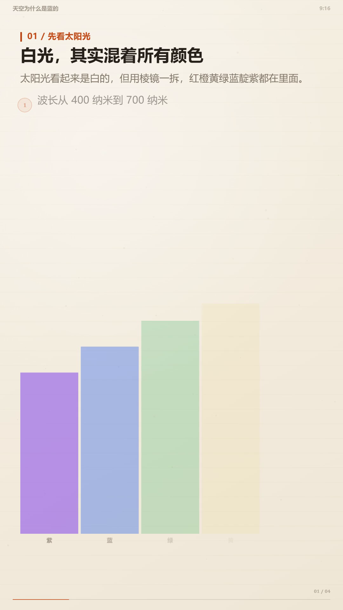

# video-flow

> 把任意内容（PDF / PPT / DOCX / Markdown / 网页 / 视频 / 一个主题）制作成“代码渲染”的可视化讲解视频。
> `render(t)` → headless Chrome 逐帧截图 → FFmpeg + 可选 TTS / 配乐 / 字幕 / 质检。

这是一个 **Claude Code / Codex / Cursor 等编码 Agent 可执行的 Skill**，也是一套可独立运行的 Python 工具链。
它把“做一条讲解视频”拆成 8 个可检查的阶段，并给出每个阶段的产物、脚本和验收标准。

---

## 它解决什么问题

- 一份 10 页的 PDF，直接念稿没人看；需要**重组教学结构 + 可视化**；
- 视频生成模型写字会糊、数字会错、改一帧要整段重来；
- 代码渲染方案可复现、文字清晰、任意一帧可单独重渲，但工程细节多、容易踩坑；
- 每次做视频都从零搭环境、调音频、对时间轴，效率低。

video-flow 把这些经验固化成：**流程 + 模板 + 脚本 + 风格库 + QA**。

---

## 演示

[](examples/demo-sky/out/final.mp4)

`examples/demo-sky/` 是用本 Skill 从零生成的 45 秒竖屏示例（9:16 / paper 风格 / Xiaoxiao 旁白）：

- 成片：[`examples/demo-sky/out/final.mp4`](examples/demo-sky/out/final.mp4)
- 封面：[`examples/demo-sky/out/poster.png`](examples/demo-sky/out/poster.png)
- 质检：[`examples/demo-sky/qa/report.md`](examples/demo-sky/qa/report.md)
- 输入：一个主题（“天空为什么是蓝的”），不是现有 PDF

它验证了：换主题、换画幅（9:16）、换风格（paper）、换声音，流程不用改代码。

---

## 快速开始

```bash
# 1) 检查环境
python scripts/check_env.py

# 2) 建项目
python scripts/init_project.py --dir my-video --title "我的讲解视频" --format 16:9 --style silicon

# 3) 编辑 my-video/script.json（或先用 examples/demo-sky/script.json 跑通）

# 4) 生成旁白与时间轴
python scripts/tts.py --project my-video
python scripts/timeline.py --project my-video

# 5) 逐帧渲染（自动启动 Chrome，或 --cdp 连已有实例）
python scripts/render.py --project my-video --launch-chrome

# 6) 音频、字幕、编码、质检
python scripts/audio.py --project my-video
python scripts/srt.py --project my-video
python scripts/encode.py --project my-video
python scripts/qa.py --project my-video
```

或一键：

```bash
python scripts/run_pipeline.py --project my-video --launch-chrome
```

**输入转换**：

```bash
python scripts/ingest.py --input source.pdf --out source/
python scripts/ingest.py --input slides.pptx --out source/
python scripts/ingest.py --input https://example.com/post --out source/
```

---

## 目录

```
video-flow/
├── SKILL.md                  # Agent 的执行手册（工作流/硬规则/验收）
├── references/
│   ├── pipeline.md           # render(t) 契约、时间轴、CDP、FFmpeg 参数
│   ├── inputs.md             # PDF/PPT/DOCX/URL/视频抽取与 OCR 兜底
│   ├── storytelling.md       # 4 种教学结构、节奏表、文案规则
│   ├── styles.md             # 5 套视觉风格
│   ├── formats.md            # 16:9 / 9:16 / 1:1 / 4:5 与安全区
│   ├── audio.md              # TTS/真人录音、配乐、ducking、响度
│   └── qa.md                 # 验收清单与自动检查
├── scripts/
│   ├── check_env.py          # 环境检查
│   ├── ingest.py             # 源材料 → source.md
│   ├── init_project.py       # 项目脚手架
│   ├── tts.py                # edge / sapi / 真人录音
│   ├── timeline.py           # 分镜 + 旁白 → timeline.js/json
│   ├── render.py             # CDP 逐帧渲染（可续渲/静帧/运动模糊）
│   ├── audio.py              # BGM/SFX/混音/ducking/母带
│   ├── srt.py                # 字幕
│   ├── encode.py             # 一次 H.264/AAC 编码 + 软字幕
│   ├── qa.py                 # 黑帧/响度/流信息/抽帧报告
│   ├── run_pipeline.py       # 顺序跑全流程
│   └── pdf_to_png.ps1        # Windows 无 pymupdf 时的 PDF 栅格化
├── templates/
│   ├── build/                # index.html + lib.js + scenes.js + custom.js
│   ├── styles/               # silicon / paper / blueprint / neon / swiss
│   └── script.example.json   # 示例分镜
└── examples/demo-sky/        # 完整示例（含成片）
```

---

## 核心设计

1. **画面是时间的纯函数**：`window.render(t)`；不读系统时间、不用无种子随机、跨帧不存状态。
   → 可乱序并行渲染、可只重渲某段、结果可复现。
2. **时间轴唯一事实来源**：分镜/旁白/配乐/音效/字幕都从 `timeline.json` 派生。
3. **先分镜后代码**：`storyboard.md` + `script.json` 是入口；通用镜头直接由数据驱动，专业图才写 `custom.js`。
4. **一次编码**：音频在 WAV 阶段完成混音/母带，最终只做一次 AAC 256k；避免反复转码。
5. **QA 是流程的一部分**：黑帧、响度、真峰值、字幕、抽帧，不通过不交付。

---

## 环境

- Python 3.10+，`numpy scipy pillow pypdf python-pptx python-docx requests lxml websocket-client`
- FFmpeg / ffprobe
- Chrome / Chromium / Edge
- （可选）`edge-tts`，用于中文神经语音；无网络可用 `--engine sapi` 或真人录音

已在 Windows 11 + Chrome 155 + Python 3.12 + FFmpeg 8.1 上跑通。
> Chrome 在受限 sandbox 中可能因 IPC/管道被禁止而无法启动；此时在允许的环境运行，或用 `--cdp` 连接一个已启动的 Chrome。

---

## 扩展

- **新风格**：复制 `templates/styles/*.json` 改色板/字体/背景；`lib.js` 的 `drawBackground` 增加背景类型。
- **新镜头**：在 `templates/build/scenes.js` 注册 `window.SCENES_IMPL[type]`，或在 `build/custom.js` 按场景 id 写专业图。
- **真人配音**：录音按 `<scene-id>.wav` 放 `audio/vo_human/`，`tts.py --engine from-dir` 只做重采样/轻处理。
- **多语言**：`script.<lang>.json` + 对应声线；时间轴自动重算。
- **多画幅**：改 `project.format` 重新 init/render；布局由 `layout()` 适配。

---

## 许可与素材

- 代码/模板：MIT（可商用、可修改）。
- 示例中的语音为 Edge TTS 生成；配乐为 numpy 程序化合成，无第三方版权素材。
- 使用他人 PDF/PPT/图片/音乐时，请自行确认授权。
